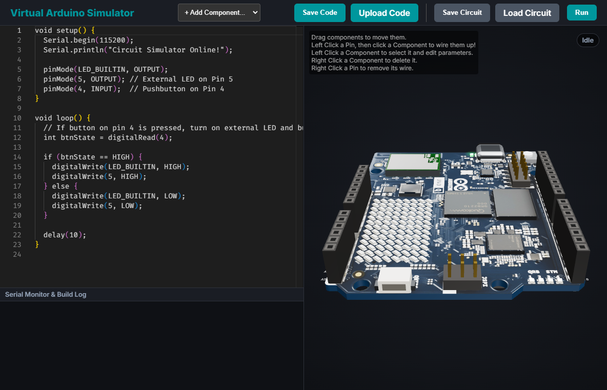

# Virtual Arduino Simulator

A powerful, interactive 3D Arduino simulator built with React Three Fiber and Electron. This application allows you to build, wire, and write code for your own electronic circuits completely virtually, rendering everything in a beautiful interactive 3D environment.



## ✨ Features

- **Interactive 3D Environment**: Orbit, pan, and zoom around a fully rendered 3D workspace powered by `@react-three/fiber`.
- **Real Circuit Physics**: The circuit is solved electrically ~50 times a second (nodal analysis with Newton-Raphson for LEDs, diodes and transistors, time stepping for capacitors and inductors). Voltages and currents follow Ohm's and Kirchhoff's laws, through wires, breadboard rows and power rails.
  - The UNO Q's GPIOs are 3.3 V outputs with a realistic output resistance and a 20 mA limit. The 5V, 3V3 and 1V8 rails switch off on a short circuit.
  - Inputs read the real node voltage, with Schmitt-trigger thresholds. `INPUT_PULLUP`/`INPUT_PULLDOWN` are supported, a floating input reads random values, and `analogRead()` returns the actual voltage (10-bit).
  - Parts have real ratings and **burn out** when overloaded. For example, an LED without a series resistor on 5 V, a 10 Ω resistor across 5 V, or a reversed electrolytic capacitor. A burnt part can be replaced from its properties panel.
  - Warnings explain what is wrong: pin overcurrent, floating inputs, 5 V on A0/A1, a motor driven straight from a pin, and more.
- **Component Library**: Includes a wide array of interactive components:
  - **Inputs**: Pushbuttons, Slide Switches, Potentiometers, FSR 402 force sensors (hold the mouse on the disc to press it with the force set in its properties; ≈ 16 kΩ at 100 g down to ≈ 250 Ω at 10 kg, open when released).
  - **Outputs**: LEDs, Buzzers, DC Motors, coin vibration motors (1027, 3 V), Servo Motors, OLED Displays, WS2812B-2020 LED strips (8 pixels, lit from `Adafruit_NeoPixel` on the pin wired to DIN, also through a series resistor).
  - **Servos** come as SG90 (4–7.2 V), Micro 1S (3.4–6 V, e.g. DM-S0020, for a 1S LiPo) or Linear 1.5g (3.5–6 V, a flat 21.4 × 15.2 × 6 mm servo whose slider travels 9 mm). With `ledcAttach()` or `ESP32Servo` they read the pulse width like a real servo (544–2400 µs at 50 Hz); with `analogWrite()` the duty is the position.
  - **Passives**: Resistors, Capacitors, Inductors, Transistors, Diodes.
  - **Drone**: LiPo battery (cell count and charge, e.g. `4S 3.9V`; add the capacity for a small pouch cell, e.g. `1S 3.9V 200mAh`, which has ≈ 190 mΩ and a 2C limit), ESC with brushless motor and propeller (5 V BEC; with `ledcAttach()` at 40-500 Hz it reads the 1000-2000 µs pulse like a real ESC, with `analogWrite()` the PWM duty is the throttle), MPU-6050 / GY-521 IMU (answers at 0x68 through `Wire` when powered and wired to the board's A4 SDA / A5 SCL, as a level, motionless sensor) and ExpressLRS receiver (electrical only: `Serial1`, and `Serial0` on the Nano ESP32, exist but carry no data).
  - **Boards**: Arduino UNO Q (ABX00162), Arduino Nano ESP32 (ABX00083) or Seeed Studio XIAO ESP32C3 as the main board, picked from the toolbar, plus standard half-size breadboards (400 tie-points).
- **Integrated Code Editor**: Built-in Monaco editor (the engine behind VS Code) for writing standard Arduino C++ code.
- **Three main boards**: choose **Arduino UNO Q**, **Arduino Nano ESP32** or **Seeed XIAO ESP32C3** in the toolbar. The sketch is compiled for the selected board, and the scene shows only that board, so you can see exactly which connections each circuit needs.
  - Each board has its own pin map and electrical model. The Nano ESP32 is 3.3 V only (no 5 V tolerance), sources up to 40 mA and sinks up to 28 mA per pin, gives 5 V only on VBUS, and has a 12-bit ADC. Its A0–A7 are Arduino pins 17–24, and its onboard RGB LED (D14–D16) is active LOW.
  - The XIAO ESP32C3 (21 × 17.8 mm) uses GPIO numbers like the Arduino-ESP32 variant: D0–D3 are GPIO2–5 (the only ADC pins, A0–A3), D4/D5 are GPIO6/7 (SDA/SCL), D6/D7 GPIO21/20, D8–D10 GPIO8–10. It is 3.3 V only, has no user LED, and its BAT+ / BAT- pads are under the board (orbit the camera to reach them): BAT- is GND, BAT+ only joins the battery wires, since the board is assumed powered over USB. Its PCB artwork is drawn from the published dimensions, not from an official render.
  - ESP32 sketches can use `analogReadMilliVolts()`, `analogReadResolution()`, `ledcAttach()`/`ledcWrite()` (and the 2.x `ledcSetup`/`ledcAttachPin`), `Serial.printf()`, `attachInterrupt()`, `String`, `map()`, `constrain()`, `random()` and `tone()`, plus the mock libraries `ESP32Servo.h`, `Adafruit_NeoPixel.h` and `Preferences.h` (kept in a file for as long as the app runs, so values survive Stop / Run like flash). Wi-Fi/Bluetooth are not simulated.
- **Coloured jumper wires**: wires are coloured by convention when you draw them (black = GND, red = 5 V, orange = 3.3 V, other colours for signals). Click a wire to recolour it or delete it.
- **Real-time Compilation & Simulation**: Your sketch is compiled with g++ against a mock Arduino core and runs as a native process, exchanging pin states with the circuit simulation. This works both in the desktop app and in the browser. Click a virtual button, and your C++ `digitalRead` catches it instantly!
- **Save & Load Functionality**: Easily save your code (`.ino`) and your physical circuit configurations (`.json`) and share them with others.

## 🚀 Tech Stack

- **Frontend Core**: React 18, TypeScript, Vite
- **3D Rendering**: Three.js, `@react-three/fiber`, `@react-three/drei`
- **Desktop Environment**: Electron
- **Compiler integration**: Node.js `child_process` running g++ (`electron/runner.js`). It is used by the Electron main process and, for the web interface, by a Vite dev-server plugin.
- **Styling**: Vanilla CSS with modern dark-mode aesthetics
- **Interaction**: `@use-gesture/react` for intuitive drag-and-drop mechanics

## 🛠️ Installation & Setup

Before running this project, ensure you have [Node.js](https://nodejs.org/) installed, as well as a C++17 compiler (`g++`) accessible in your system's PATH. On Windows, use [MinGW-w64](https://www.mingw-w64.org/), e.g. via WinLibs or MSYS2.

1. **Clone the repository:**
   ```bash
   git clone https://github.com/yourusername/virtual-arduino.git
   cd virtual-arduino
   ```

2. **Install dependencies:**
   ```bash
   npm install
   ```

3. **Run it in the browser** (development server; the dev server compiles and runs your sketches):
   ```bash
   npm run dev
   ```
   Then open http://localhost:5173.

4. **Or run the desktop app** (Electron loads the production build, so rebuild after changes):
   ```bash
   npm run build
   npm start
   ```

## 🎮 How to Use

1. **Add Components**: Use the dropdown in the top-left toolbar to add an Arduino, breadboard, LEDs, etc.
2. **Move Components**: Drag any component directly across the 3D table.
3. **Wire Components**: Click on any pin, breadboard hole, or component leg to start a wire. Click on any other pin to connect them. The wire will dynamically follow your cursor.
4. **Wires and components**: Click a wire to change its colour or delete it; right-click a wire to delete it straight away. Right-click a component to delete it via a confirmation prompt.
5. **Inspect and edit parts**: Click a component to open its panel. It shows the live voltage, current and power against the part's rating, and lets you edit values (resistance, capacitance, LED colour…).
6. **Write Code**: Use the integrated code editor to write standard Arduino C++.
7. **Simulate**: Click the green "Run" button! Your code will compile and execute, sending real-time signals back and forth between the C++ engine and the 3D frontend. Wire things as you would on a real bench. Three examples are included:
   - **UNO Q**: `test.ino` with `circuit_test.json`. A button from D4 to GND using `INPUT_PULLUP`, and an LED on D5 with a 220 Ω resistor.
   - **Nano ESP32**: `esp_test.ino` with `esp_test.json`. Loading the circuit also selects the board. A button on D4, a PWM-dimmed LED on D5, and a potentiometer on A0 powered from 3V3 (never 5 V on an ESP32 pin).
   - **XIAO ESP32C3**: `xiao_webshooter.ino` (the board's default sketch) with `xiao_webshooter.json`, the wrist-mounted web shooter. A 1S 200 mAh LiPo behind a slide switch feeds a flat 1.5 g linear servo (signal on D10) that opens a pinch valve through a 3:1 bell crank, an 8-pixel WS2812B strip (DIN on D4 through 330 Ω) showing the battery and fluid gauges, and a coin vibration motor (NPN on D3, with a flyback diode). Hold the FSR (D1, 10 kΩ to GND) to fire; the button on D5 changes mode (continuous, burst, single shot) and, held for 1.5 s, refills the cartridge; a 100k/100k divider on D2 reads the battery.

## 🤝 Contributing

Contributions, issues, and feature requests are welcome! Feel free to check the [issues page](https://github.com/yourusername/virtual-arduino/issues).

## 📝 License

This project is licensed under the MIT License.
